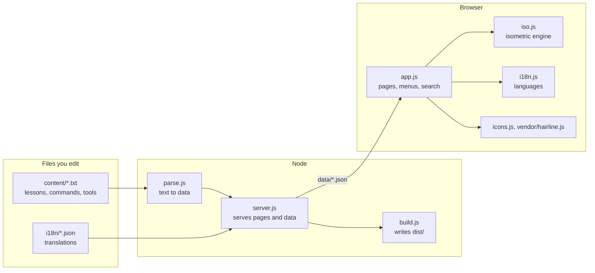

# Opsyard: project guide

Everything needed to understand, run, change and contribute to this project.

**Contents:** [1 What it is](#1-what-it-is) · [2 Run it](#2-run-it) · [3 Architecture](#3-architecture) · [4 Every file](#4-every-file) · [5 What happens when you click](#5-what-happens-when-you-click) · [6 Add or change a lesson](#6-add-or-change-a-lesson) · [7 Commands and tools](#7-commands-and-tools) · [8 Languages](#8-languages) · [9 Look and icons](#9-look-and-icons) · [10 Contribute](#10-contribute) · [11 Publish](#11-publish) · [12 Problems](#12-problems) · [13 Limits and ideas](#13-limits-and-ideas)

---

## 1 What it is

Opsyard teaches DevOps from zero to advanced. Each idea is a short lesson. The reader presses **Next**, the text on the right changes, and an isometric animation in the middle shows what just happened.

It is free: no login, no account, no payment. Progress is kept in the reader's own browser.

| Subject | Lessons | | Subject | Lessons |
|---|---|---|---|---|
| Software Lifecycles | 32 | | Kubernetes | 23 |
| Linux and Networking | 18 | | Ansible | 11 |
| Git | 17 | | Terraform and IaC | 12 |
| GitHub | 12 | | AWS | 32 |
| CI/CD | 12 | | Observability and SRE | 12 |
| Jenkins | 14 | | DevSecOps | 11 |
| Docker | 18 | | **All 13 subjects** | **224 lessons, 1,113 steps** |

Besides lessons: 231 commands with animations and a risk label, and 30 Ubuntu and Kali tools with purpose, usage, risks and guidelines. Ten languages.

Every subject follows the same order:

1. **Why it exists**: the problem people had, and how this solved it.
2. **A short history**: a timeline.
3. **Concepts one by one**: without it, what it is, how it works, a real-time example.
4. **Flows**: how the concepts work together in real situations.

The real-time examples are illustrative situations, not reports about named companies.

---

## 2 Run it

You need [Node.js](https://nodejs.org) 20 or newer. Nothing else: there are no packages to install.

Check your version:

```powershell
node -v
```

Open a terminal in the project folder (the one that holds `server.js`), then start the site:

```powershell
node server.js
```

Open **http://localhost:4173** in a browser. Stop the server with `Ctrl + C`.

| Task | Command |
|---|---|
| Start the site | `node server.js` |
| Start on another port (PowerShell) | `$env:PORT=5000; node server.js` |
| Start on another port (Linux, macOS) | `PORT=5000 node server.js` |
| Check everything | `npm test` |
| Make files for a web host | `npm run build` (writes `dist/`) |

A passing test ends with a line such as:

```
ok: 13 subjects, 224 lessons, 1113 steps, 231 commands, 30 tools
```

**When do changes show?**

| You changed | Then |
|---|---|
| `public/*` (look, pages, engine) | Refresh the browser (`Ctrl + F5`) |
| `i18n/*.json` (translations) | Refresh the browser |
| `content/*.txt` (lessons) | Restart the server, then refresh |
| `server.js`, `parse.js`, `strings.js` | Restart the server |

**Keys in a lesson:** right and left arrow = step, `R` = replay, `Space` = pause, `Ctrl K` = search.

---

## 3 Architecture

There is no framework, no database and no build step while developing. Text files become data, and the browser draws that data.



| Address | What it returns |
|---|---|
| `/` | `public/index.html` |
| `/data/catalog.json` | All subjects, chapters and lesson titles |
| `/data/lesson/<id>.json` | One full lesson |
| `/data/commands.json`, `/data/tools.json` | The two reference sections |
| `/data/i18n/<language>.json` | Translations, read from disk at each request |

Page addresses in the browser use the part after `#`, so any static host works:

| Address | Page |
|---|---|
| `#/` | Home |
| `#/l/c-iam/3` | Lesson `c-iam`, step 3 |
| `#/commands/docker/8` | Commands, Docker, number 8 |
| `#/tools/16/kali` | Tool 16, filtered to Kali |

**Stored in the reader's browser (localStorage):** `done` (finished lessons), `lang`, `theme`. Nothing is sent to the server.

**Safety:** the server only answers GET and HEAD, only serves known file types from `public/`, refuses paths outside it, and sends a content security policy that allows scripts only from the site itself. The fonts come from Google Fonts; without internet the site still works with system fonts.

---

## 4 Every file

```
opsyard/
├─ PROJECT.md            this guide
├─ README.md             overview and quick start
├─ vercel.json           deployment settings
├─ LICENSE               code licence (MIT)
├─ LICENSE-CONTENT.md    course content licence (CC BY-NC 4.0)
├─ docs/                 pictures for the README
├─ package.json          the start, test and build commands
├─ server.js             local web server
├─ parse.js              reads content/*.txt
├─ strings.js            lists every text to translate
├─ build.js              writes dist/
├─ test.js               checks everything
├─ content/              LESSONS: what most people edit
│  ├─ 01-sdlc-a … g.txt  Software Lifecycles, in parts
│  ├─ NN-name-0.txt      introduction and concepts of a subject
│  ├─ NN-name.txt        flows of that subject
│  ├─ commands.txt       command reference
│  └─ tools.txt          Linux tool guides
├─ i18n/                 translations, one JSON per language
├─ notes/                explanations by contributors
├─ translate/            scripts that fill i18n/
└─ public/               what the browser loads
   ├─ index.html         the empty page frame
   ├─ style.css          all styles, light and dark
   ├─ app.js             pages and behaviour
   ├─ iso.js             isometric scenes
   ├─ i18n.js            menu texts and language loading
   ├─ icons.js           icons (generated)
   ├─ favicon.svg
   └─ vendor/            hairline figures, licences
```

### Node side

| File | What it does | Main parts |
|---|---|---|
| `parse.js` | Turns the lesson language (section 6) into objects. Draws default scenes for concept and history lessons. Joins files with the same subject id. | `parseSubject`, `defaults`, `load` |
| `server.js` | Small web server. Reads lessons once at start; reads translations live. Compresses data. | `dataFiles`, `langJson`, `server` |
| `strings.js` | Collects every visible text except code. `FIXED` holds small texts that live in `app.js`. | `strings` |
| `build.js` | Copies `public/` and all data into `dist/`. | |
| `test.js` | Fails on: unknown shapes or names, moves to hidden things, duplicate ids, two things on one cell, missing quiz or text, bubbles that are too long, broken addresses. Untranslated text is only a note. | |

### Browser side

| File | What it does | Main parts |
|---|---|---|
| `app.js` | Decides which page to show, builds menus, steps, quiz, search, theme, language. | `route`, `chrome` (sidebar and top bar), `showLesson`, `paint` (one step), `home`, `commands`, `tools`, `find`, `changeLang` |
| `iso.js` | Draws and animates scenes in SVG. | `SHAPES` (every object), `ROLES` (people by label), `NAMED` (brand icon by label), `TONE` (colours), `Scene`, `stateAt` |
| `i18n.js` | Menu texts of 10 languages; finds the translation of a sentence. | `t` (menu text), `known` (lesson text), `loadLang`, `key` |
| `icons.js` | Brand marks and interface icons as paths. | `ui`, `brand`, `subject` |
| `style.css` | Colours as variables at the top, then layout, scene styles, pages, small screens. | |
| `vendor/hairline.js` | Line figures on the home cards ([hairline](https://github.com/lucasmarkes/hairline), MIT). | |

### How the engine works (`iso.js`)

- The ground is a grid. `x` runs right-down, `y` runs left-down. One cell holds one object.
- `Scene.build` draws all objects once, hidden. `Scene.apply` shows the state of a step: who is visible, highlighted, linked. Because objects stay, changes glide instead of jumping.
- `stateAt(lesson, i)` adds up steps 0 to i, so **Back** always shows the right picture.
- `Scene.run` plays the step's acts in order: `flow` (moving dots), `walk` (a person carries a document), `say` (speech bubble). Every move is a Web Animation, so pause and speed work on all of them.
- `Scene.camera` frames what is visible.
- With "reduce motion" switched on in the system, scenes stay still and show links and first bubbles.

---

## 5 What happens when you click

Example: the reader presses **Next** in lesson `c-iam`, step 2.

1. `app.js` `go(1)` changes the address to `#/l/c-iam/3`.
2. The browser reports the change and `route()` calls `showLesson('c-iam', 3)`.
3. The lesson is already in memory, so nothing is downloaded and the scene is kept.
4. `paint()` writes the text of step 3. Each paragraph slides in slightly after the one before.
5. `stateAt(lesson, 2)` works out what is visible now (steps count from 0 inside the code).
6. `scene.apply()` lifts highlighted objects, draws new links, moves the camera, then `run()` plays the moves.
7. On the last step the quiz appears. **Finish lesson** stores the lesson id in `done` and opens the next lesson.

Changing the language: `changeLang('es')` downloads `data/i18n/es.json` once, then draws the page again. `known(text)` looks up each English sentence; if there is no translation, the English is shown.

---

## 6 Add or change a lesson

Lessons are plain text in `content/`. No programming needed. Files whose names start with a number are subjects, in name order; files with the same `% id` are joined (`11-aws-0.txt` comes before `11-aws.txt`).

### A complete concept lesson

This is the easiest kind. The scenes are drawn for you. Paste it under a `## chapter` in a file such as `content/11-aws-0.txt`:

<!-- example:start -->
```text
# c-sns-demo | SNS: one message, many readers | Beginner | Tell everyone at once.
@@ server Shop ; flag SNS topic ; team Subscribers ; queue Email and queue
= Without it | PROBLEM
The shop calls email, stock and invoice one after another. One slow service makes the buyer wait.
= What it is | SOLUTION
**SNS** is a topic. You send one message and every subscriber gets a copy.
= How it works
Services **subscribe** to the topic. The shop only publishes; it does not know who listens.
$ aws sns publish --topic-arn arn:aws:sns:eu-west-1:111122223333:orders --message "order 1009"
= Real-time example | PRACTICE
A ticket seller adds a text-message service. Nothing in the shop changes: the new service subscribes.
? Who knows the list of listeners? | The shop | *The topic | The buyer
^ https://docs.aws.amazon.com/sns/latest/dg/welcome.html SNS Developer Guide
```
<!-- example:end -->

`@@` takes up to five things: the **actor**, the **concept**, what it **acts on**, and one or two helpers. Step 1 shows the actor failing without the concept, step 2 brings the concept in, step 3 the helpers, later steps the full circle.

### A lesson with your own scene

<!-- example:start -->
```text
# demo-handover | A handover | Beginner | Two people and a server.
@ dev user 0 0 Developer
@ ops user 1 0 Operations
@ srv rack 2 0 Production | Frankfurt
= Ready to go
+ dev ops
" dev Version 2 is ready.
w dev>ops release notes
The developer explains the change before it is released.
! A handover without words loses information.
= Release | PRACTICE
+ srv
* ops srv
~ ops>srv deploy
: srv ok live
Operations puts the new version in place and watches it.
| Check | Result |
| Login works | yes |
| Errors | none |
= Report back
~ srv>ops healthy
w ops>dev all good
Operations tells the developer how the release behaves.
? What should come with a release? | Silence | *An explanation | A party
```
<!-- example:end -->

### All line types

| Line starts with | Meaning | Example |
|---|---|---|
| `%` | Subject: id, title, colour, description | `% aws \| AWS \| #b5651d \| Cloud services` |
| `##` | Chapter | `## Storage services` |
| `#` | Lesson: unique id, title, level, summary | `# c-s3 \| S3 \| Beginner \| Files by name` |
| `@` | Object: id, shape, x, y, label, optional small text | `@ db db 2 0 Database \| port 5432` |
| `@@` | Concept lesson | see above |
| `@h` | History lesson, one milestone per step | `@h 1991 Linux ; 2004 Ubuntu` |
| `Z` | Zone on the ground: id, x, y, width, height, label | `Z vpc 0 0 3 2 VPC` |
| `=` | Step: title, optional tag | `= What it is \| SOLUTION` |
| `+` / `x` | Show / remove objects | `+ db app` |
| `*` | Highlight | `* db` |
| `~` | Moving dots; `!` = failing; `;;` = several | `~ app>db query ;; !db>app error` |
| `w` | A person walks over with a document | `w dev>qa build 2` |
| `"` | Speech bubble, at most 90 characters | `" qa Refund fails.` |
| `:` | Colour and badge: ok, err, warn, info, off | `: db err down` |
| plain text | Paragraph; `**bold**` and `` `code` `` work | |
| `!` / `!!` | Key idea / warning | `! Small changes are safer.` |
| `$` / `>` | Command / output or file content | `$ docker ps` |
| `\|` | Table row; the first is the header | `\| Type \| For \|` |
| `?` | Quiz, once per lesson; `*` marks the right answer | `? 2+2 \| 3 \| *4` |
| `^` | Source link | `^ https://… Title` |

**Tags:** CONCEPT (default), PROBLEM, SOLUTION, PRACTICE, RISK, HISTORY, SCALE.

**Shapes:** `user team` (people) · `laptop server rack router cloud` · `db bucket folder doc card board` · `cube small gear box stack layer pod queue` · `shield key gate flag gauge commit`

**Rules the test checks**

- Lesson ids are unique in the whole course. Every lesson has at least 3 steps.
- Every step has text or a table. One quiz per lesson, with exactly one right answer.
- Objects never named after `+` are visible from the start. A move may only touch visible objects.
- No two objects on the same cell.
- Only `user` and `team` can walk (`w`).

**Colours and icons come from words.** A person labelled *Tester* gets a bug icon, *Client* a briefcase. An object labelled *Docker host* gets the Docker mark. See `ROLES` and `NAMED` in `iso.js`.

Then check and look:

```powershell
npm test
```

```powershell
node server.js
```

Open `http://localhost:4173/#/l/your-lesson-id/1`.

---

## 7 Commands and tools

**`content/commands.txt`**: a group starts with `%`, then its objects, then one command per line with ` | ` between the parts:

```text
% docker | Docker
@ c laptop 0 0 CLI
@ d gear 1 0 Daemon
docker info | Daemon details. | s | d>c | --format json = as JSON | Works without any container.
```

Parts: command, what it does, risk (`s` read only, `c` makes changes, `d` destructive), moves, flags separated by `;;` as `flag = meaning`, and a tip. A command must not itself contain ` | ` with spaces.

**`content/tools.txt`**: one block per tool:

```text
# name | Ubuntu, Kali | apt-package | Category | s
purpose: What it is for.
where: When to use it.
$ command # what this does
risks: What can go wrong.
guide: How to use it safely.
src: https://official-page
```

Risk is `s` low, `c` medium, `d` high. For security testing tools, use examples only against your own lab, and always state that permission is needed.

---

## 8 Languages

English, Telugu, Hindi, Spanish, French, Portuguese, German, Japanese, Korean and Traditional Chinese.

- **Menus** are written by hand in `public/i18n.js`.
- **Lessons** are translated into `i18n/<language>.json` as `"English sentence": "translation"`. This is machine translation (NLLB-200) with some hand corrections, and it needs review by native speakers.

**Correct a sentence:** open the file, change the text on the right, save, refresh the page. No programming needed, and very welcome. A few headings and names are kept in `translate/hand.json` and `translate/post.py`; change those there, because they are written again on each run.

**New or changed English text** shows in English until it is translated. `npm test` says how many are missing. Two ways:

1. Add the sentence to each JSON file yourself.
2. Run the translator (needs Python 3 and about 1.5 GB):

```powershell
python -m pip install --target "$HOME/opsyard-translate/pkgs" ctranslate2 tokenizers huggingface_hub
```

```powershell
python translate/download.py
```

```powershell
python translate/translate.py
```

It fills only what is missing. For Chinese, `python translate/zhfix.py` then redoes sentences that stop early (`zhfix.py show` previews them). `python translate/translate.py es,fr` does chosen languages. Another place for the model: set `OPSYARD_NLLB` to a folder.

> **Licence:** the NLLB model is CC-BY-NC 4.0, for non-commercial use. If the site is ever sold, replace these translations.

---

## 9 Look and icons

- Colours are variables at the top of `style.css`, once for light and twice for dark (system setting and the button). The pastel block colours are `--p-blue`, `--p-teal` and so on.
- **A new shape:** add a function to `SHAPES` in `iso.js` that returns SVG. Build it from `box`, `cyl` and `panel`. Give it a colour in `TONE` and a label icon in `LABEL`.
- **A new role for people:** add a line to `ROLES`.
- **Icons** in `icons.js` come from Simple Icons (CC0), Devicon (MIT, AWS) and Lucide (ISC). Brand marks belong to their owners and only name the tools being taught.

---

## 10 Contribute

You do not need to be a programmer.

| You want to | Do this | Skill |
|---|---|---|
| Explain a concept your own way with a real-time example | Add a note: [notes/README.md](notes/README.md) | Writing |
| Fix a translation | Edit `i18n/<language>.json` | A language |
| Fix a mistake in a lesson | Edit `content/*.txt` | Writing |
| Add a lesson, command or tool | Sections 6 and 7 | Writing |
| Add a shape or animation | `public/iso.js` | JavaScript, SVG |
| Change pages or style | `public/app.js`, `style.css` | JavaScript, CSS |

**Workflow with Git:**

```powershell
git switch -c add-sns-lesson
```

```powershell
npm test
```

```powershell
git add .
```

```powershell
git commit -m "Add SNS lesson"
```

```powershell
git push -u origin add-sns-lesson
```

Then open a pull request. Say what you changed and why, and add a screenshot for visual changes.

**Before you send it**

- [ ] `npm test` ends with `ok:`
- [ ] You looked at every step in the browser, in light and dark
- [ ] Facts are checked against official documentation, with a `^` source where it matters
- [ ] Your own words: no copied text, pictures or code from other sites
- [ ] Examples are invented situations; no real company secrets, names of private people, passwords or keys
- [ ] Simple English, short sentences: many readers are beginners, and simple text translates better

**How notes become lessons:** a maintainer reads a note, agrees the idea with its author, and turns it into a lesson with a scene. The author is named in the note.

---

## 11 Publish

The code is at https://github.com/perumallavishnu/opsyard.

**Licences:** code is [MIT](LICENSE); lessons, translations, notes and documentation are [CC BY-NC 4.0](LICENSE-CONTENT.md). Contributions are published under the licence of the part they change.

**Vercel:** import the repository and deploy; `vercel.json` holds the settings. Vercel runs the tests first, so a broken version is not published.

**Another host:** run `npm run build` and upload the `dist` folder to any static host (GitHub Pages, Cloudflare Pages, Netlify). It contains everything, all languages included, and needs no server. It also works in a subfolder.

---

## 12 Problems

| What you see | Reason and fix |
|---|---|
| The page does not open | The server is not running. `node server.js` |
| `EADDRINUSE` | The port is in use, perhaps by an older copy. Close it or use another `PORT` |
| A lesson change does not show | Restart the server, then `Ctrl + F5` |
| Some text stays English | It has no translation yet; section 8 |
| Yellow bar "server did not answer" after changing language | That language file is missing or the server stopped |
| `bad flow: …` | A `~` or `w` line is not `a>b`. Several moves need `;;` |
| `unknown …` in the test | A name is used that no `@` or `Z` line defines |
| `flow to hidden …` | Show it first with `+` |
| `nodes share a cell` | Two objects have the same x and y |
| `no text` | A step has no paragraph or table |
| Animations do not move | "Reduce motion" is on in the system settings, or the scene is paused |
| Progress disappeared | It is stored per browser; private windows and cleared data lose it |

---

## 13 Limits and ideas

Known limits:

- Translations are machine made. Technical terms in the `GLOSS` list of `translate.py` stay in English; other terms may be translated too literally. Traditional Chinese is the weakest: some sentences are shortened.
- Commands are the everyday ones, not every command that exists.
- AWS covers core services. Azure and Google Cloud are only mentioned.
- Progress does not follow a reader to another device.

Good next contributions: more real-time examples as notes, practice exercises, Azure and Google Cloud subjects, Helm and Argo CD in more depth, a reading view for `notes/` inside the site, reviewed translations.
