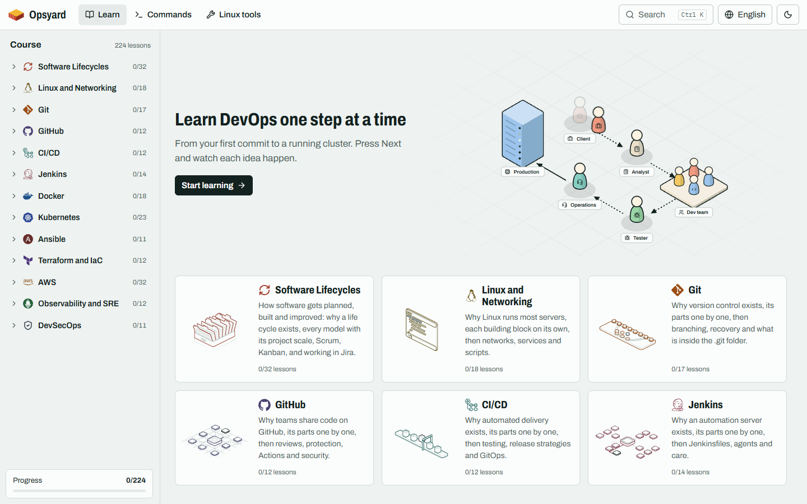
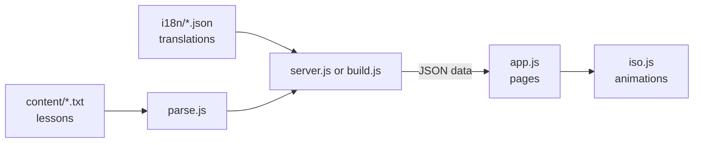

# Opsyard

**Learn DevOps by watching it happen.** A free, visual course from beginner to advanced: 13 subjects, explained one step at a time with isometric animations, in 10 languages.

No account. No payment. No packages to install.



## Contents

[Objective](#objective) · [What you learn](#what-you-learn) · [Features](#features) · [Run it](#run-it) · [Deploy on Vercel](#deploy-on-vercel) · [How it works](#how-it-works) · [Project structure](#project-structure) · [Contribute](#contribute) · [Known limits](#known-limits) · [Licences](#licences)

## Objective

DevOps is usually learned from long documents, separate videos and lists of commands. A beginner sees *what* to type, but not *what happens* when it runs, or *why* the tool was needed at all.

Opsyard has four goals:

1. **Show, not only tell.** Press **Next** and watch the request, the build, the container or the handover between people move through the picture.
2. **Start from the problem.** Every subject first explains what went wrong before the tool existed.
3. **Be complete in one place.** Concepts, real-time flows, commands, tools, risks and guidelines sit together.
4. **Be open to everyone.** Free, without sign-up, in many languages, and simple enough that people who do not program can add to it.

**Who it is for:** students, beginners, developers moving into operations, testers, managers who work with DevOps teams, and anyone preparing for an interview.

## What you learn

| Subject | Lessons | Includes |
|---|---|---|
| Software Lifecycles | 32 | SDLC models by project size, Agile, Scrum, Kanban, Jira in a real project |
| Linux and Networking | 18 | Files, permissions, processes, DNS, ports, SSH |
| Git | 17 | Commits, branches, merging, undoing |
| GitHub | 12 | Pull requests, reviews, issues, Actions |
| CI/CD | 12 | Pipelines, testing, deployment strategies |
| Jenkins | 14 | Agents, pipelines, plugins, credentials |
| Docker | 18 | Images, containers, volumes, networks, Compose |
| Kubernetes | 23 | Pods, Deployments, Services, scaling, storage |
| Ansible | 11 | Inventory, playbooks, roles |
| Terraform and IaC | 12 | State, plan, modules |
| AWS | 32 | IAM, EC2, S3, VPC and other core services |
| Observability and SRE | 12 | Metrics, logs, traces, error budgets |
| DevSecOps | 11 | Security through the whole pipeline |
| **Total** | **224** | **1,113 animated steps** |

Also included: **231 commands**, each with an animation and a risk label, and **30 Ubuntu and Kali Linux tools** with purpose, usage, risks and guidelines.

Every subject follows the same order: *why it exists* → *a short history* → *concepts one by one* → *flows that combine them*.

The security tools are described for learning and for systems you own or have written permission to test.

## Features

- Isometric scenes drawn and animated in the browser; replay, pause and step back at any time
- People appear and hand over work where a lesson is about teamwork
- A short quiz in every lesson
- Progress saved in your own browser; nothing is sent to a server
- Search (`Ctrl K`), keyboard control, light and dark theme, support for reduced motion
- English, Telugu, Hindi, Spanish, French, Portuguese, German, Japanese, Korean and Traditional Chinese

## Run it

You need [Git](https://git-scm.com) and [Node.js](https://nodejs.org) 20 or newer.

```bash
git clone https://github.com/perumallavishnu/opsyard.git
cd opsyard
node server.js
```

Open **http://localhost:4173**. There is no `npm install` step.

| Task | Command |
|---|---|
| Start the site | `node server.js` |
| Check lessons, commands, tools and server | `npm test` |
| Build the static site into `dist/` | `npm run build` |

## Deploy on Vercel

The settings are already in [vercel.json](vercel.json).

1. Sign in to [Vercel](https://vercel.com) and choose **Add New → Project**.
2. Import the `opsyard` repository.
3. Leave the settings as they are and choose **Deploy**. No environment variables are needed.

Vercel runs the tests, builds the site and publishes `dist/`. If a test fails, that version is not published. Each later push to `main` is deployed the same way.

The site is static, so any other static host works too: run `npm run build` and upload `dist/`.

## How it works



Lessons are plain text files. Node turns them into JSON, and the browser draws the scenes as SVG. Plain JavaScript, no framework, no database, no dependencies.

## Project structure

```
opsyard/
├─ content/     lessons, commands and tools as plain text
├─ i18n/        translations, one file per language
├─ notes/       explanations written by contributors
├─ public/      what the browser loads: pages, styles, animation engine
├─ translate/   scripts that fill i18n/
├─ parse.js     reads content/
├─ server.js    local web server
├─ build.js     writes dist/
├─ test.js      checks everything
└─ vercel.json  deployment settings
```

[PROJECT.md](PROJECT.md) explains every file, the lesson format and the animation engine.

## Contribute

You do not need to be a programmer.

| You want to | Where |
|---|---|
| Explain a concept your own way, with a real-time example | [notes/](notes/README.md) |
| Fix a translation | `i18n/<language>.json` |
| Fix or add a lesson, command or tool | [PROJECT.md, sections 6 and 7](PROJECT.md#6-add-or-change-a-lesson) |
| Add a shape or animation | `public/iso.js` |

1. Fork the repository and create a branch.
2. Make your change and run `npm test`.
3. Open a pull request that says what changed and why.

The full checklist is in [PROJECT.md, section 10](PROJECT.md#10-contribute).

## Known limits

- Translations are machine made and need review by native speakers. Traditional Chinese is the weakest.
- Commands are the everyday ones, not every command that exists.
- AWS covers core services; Azure and Google Cloud are only mentioned.
- Progress stays in one browser and does not follow you to another device.

## Licences

This project has **no licence file yet**, so all rights stay with its owner until one is chosen.

The translations were made with NLLB-200 (CC-BY-NC 4.0, non-commercial). Bundled icons and figures are listed in [public/vendor/LICENSES.txt](public/vendor/LICENSES.txt). Product names and logos belong to their owners and only identify the tools being taught; Opsyard is not connected to them.
